# Iziko South African National Gallery: Website, API and Android App


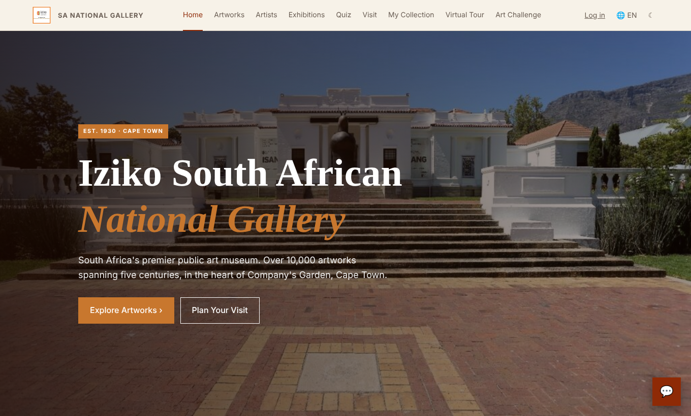

> **TODO before submitting:** replace every line marked `TODO`. Delete this note when done.

| | |
|---|---|
| **Team** | TODO: your name, teammates' names and student numbers |
| **Android repo (Kotlin)** | TODO: link |
| **Website repo** | TODO: link to this repository |
| **Live website** | TODO: your https:// link (Render) |
| **Demo video (unlisted YouTube)** | TODO: link |

## 1. Purpose
**Problem.** Visitors, learners and tourists cannot easily preview the Iziko South African National Gallery's collection, learn about its history or plan a visit before arriving.

**Users.** Tourists planning a trip to Cape Town, school and university students, teachers, and South African art lovers.

**Solution.** One shared system with two clients, an Android app (Kotlin) and this website, both using the same Python REST API, SQLite database and Google sign-in. Visitors can browse and search artworks, artists and exhibitions, test their knowledge in a quiz, earn badges, save favourites, take a virtual tour, and see prices, opening hours and directions.

**Expected impact.** More informed visits, more engagement with South African art, and educational use in classrooms through the quiz and Art Challenge.

## 2. Features
| Feature | What it does |
|---|---|
| Artworks, Artists, Exhibitions | Search by title or artist, filter by category, detail pages |
| **Google SSO** | Sign in with Google (Firebase Auth); email register/login also available |
| **Art Quiz** | Beginner, Explorer and Curator levels, scoring and shareable results |
| **Art Challenge** | Daily question, day streak, points, 5 explorer levels, 6 badges |
| **My Collection** | Heart any artwork to save it |
| **Virtual Tour** | Room-by-room walkthrough of the gallery |
| Visit | Ticket prices, opening hours, Google Map, floor map, nearby attractions |
| **Chat assistant** | Answers common questions about hours, tickets and location |
| Languages | English, Afrikaans, isiZulu, isiXhosa (menus and key headings) |
| Dark mode, offline fallback | Theme toggle; bundled data is used if the API is unreachable |

## 3. Screenshots (website)
| | |
|---|---|
| 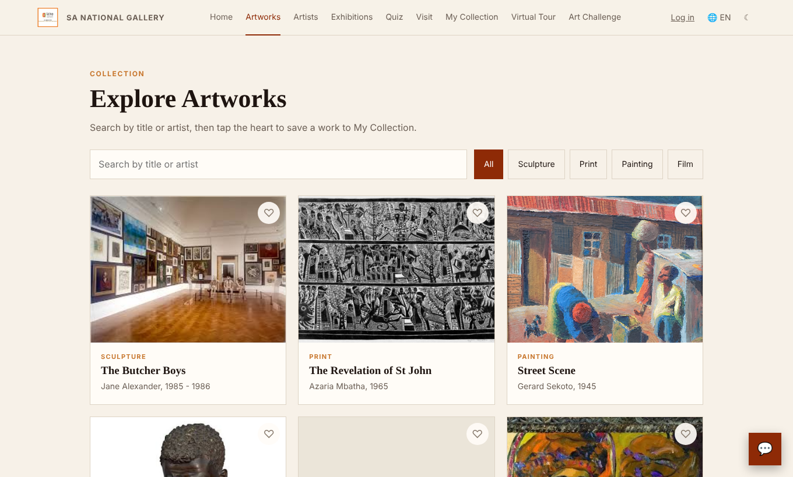<br>**Fig. 1** Artworks with search, category filters and save hearts | 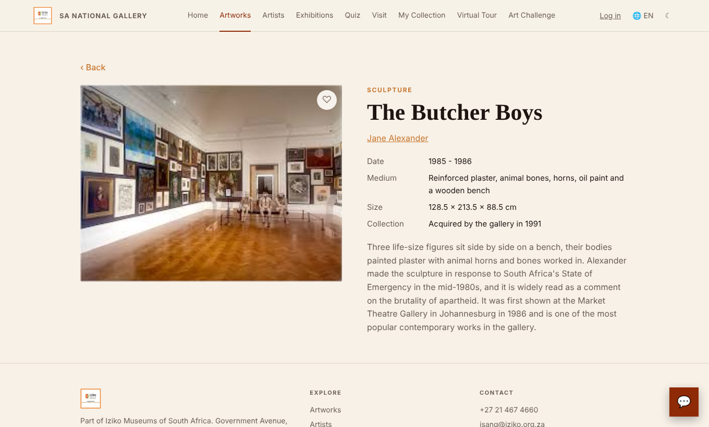<br>**Fig. 2** Artwork detail page |
| 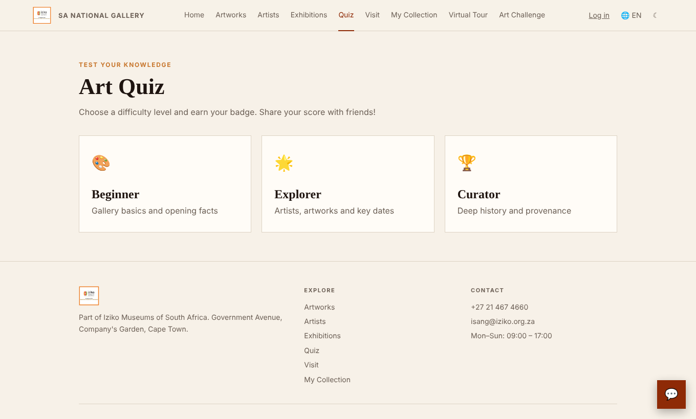<br>**Fig. 3** Quiz difficulty levels | 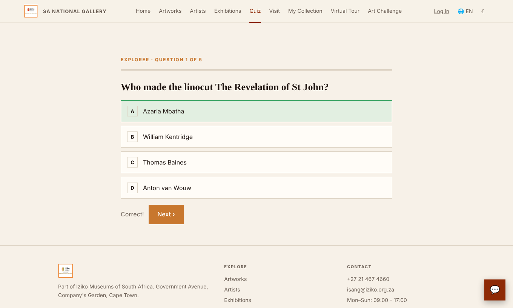<br>**Fig. 4** Quiz question with feedback |
| 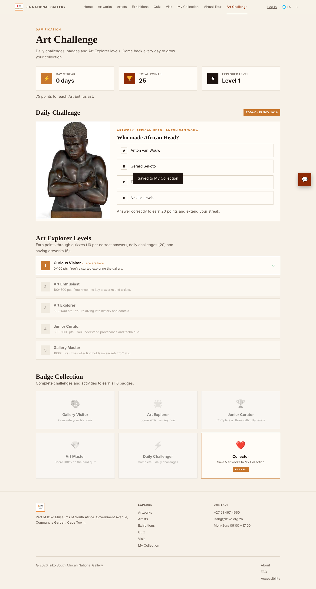<br>**Fig. 5** Art Challenge: streak, points, levels and badges | 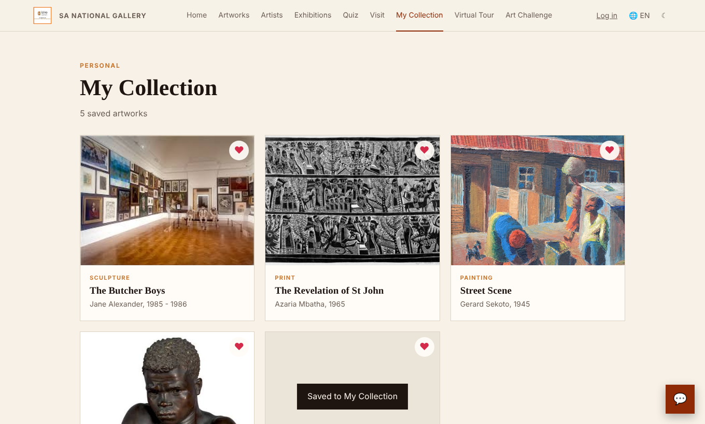<br>**Fig. 6** My Collection |
| 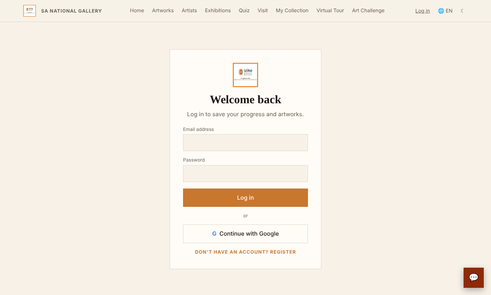<br>**Fig. 7** Login with Google SSO | 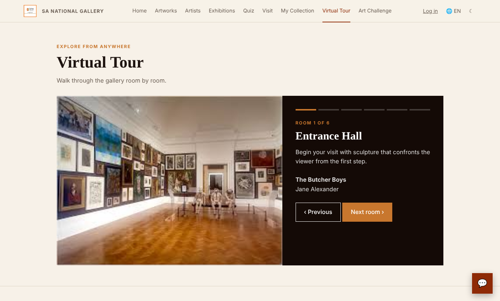<br>**Fig. 8** Virtual Tour |
| 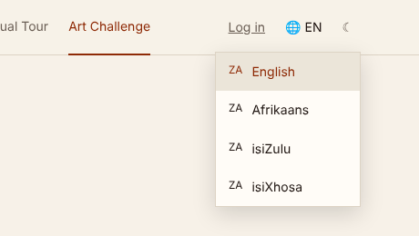<br>**Fig. 9** Language menu | 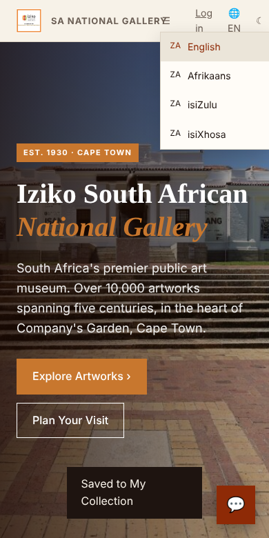<br>**Fig. 10** Website on a phone |

Visit page: 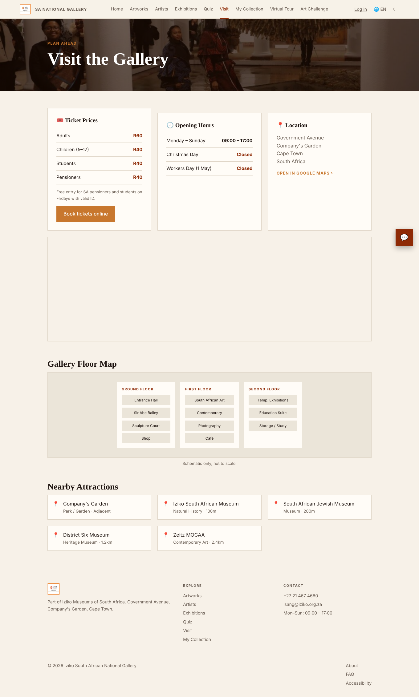

## 4. Screenshots (Android app)
TODO: add labelled screenshots of the Android app (Welcome, Login with Google, Home, Explore, Artwork, Settings) in `docs/screenshots/` and show them here with captions.

## 5. Design considerations
- **Brand and tone:** warm cream and rust palette taken from the gallery's identity, Playfair Display headings with DM Sans body text.
- **Accessibility:** visible keyboard focus, labelled buttons, `aria-current`/`aria-pressed`/`aria-live` for screen readers, sufficient contrast, and `prefers-reduced-motion` respected (W3C, 2026).
- **Responsive:** one layout from phone to desktop; the top menu becomes a menu button on small screens.
- **Dark mode** follows the device setting and can be toggled.
- **Resilience:** if the server cannot be reached the site shows saved data instead of an error.
- **Privacy:** points, badges and saved artworks are stored only in the visitor's browser.

## 6. Single sign-on (SSO)
1. The user chooses **Continue with Google**; Firebase Auth opens the Google sign-in popup (Firebase, 2026).
2. Firebase returns an ID token. The website (and the Android app) POST it to `/api/auth/firebase`.
3. The server verifies the token with the Firebase project key, creates or finds the user, and returns a session token.
4. The session token is sent as a `Bearer` header and expires after 30 days; logging out deletes it on the server and in the browser.
Because both clients use the same endpoint, one Google account works on the website and in the app.

## 7. Run it
```
cd server
python3 app.py            # http://localhost:8000
python3 app.py --reset    # re-create iziko.db from seed.json
python3 -m unittest discover tests   # from the repo root
```
Python 3.8+, nothing to install. For Google sign-in: create a Firebase project, enable Google under Authentication, paste the web config into `server/web/firebase-config.js`, add your domain under Authorized domains, and start with `FIREBASE_API_KEY=xxxx python3 app.py`.

**API:** `/api/health`, `/api/artworks`, `/api/artworks/<id>`, `/api/categories`, `/api/artists`, `/api/artists/<id>`, `/api/exhibitions`, `POST /api/auth/register|login|logout|firebase`, `GET /api/me`, `GET|POST /api/bookings`.

## 8. GitHub and GitHub Actions
- All source is in this repository (no zip files). Commits are small and described.
- `.github/workflows/ci.yml` runs on every push and pull request: it installs Python 3.11 and runs `python -m unittest discover tests -v`.
- **Automated tests (`tests/test_api.py`, 6 tests):** API health and data, registration and login, wrong-password rejection, booking rules, plus website tests that check `index.html`, `site.js`, `style.css` and the offline seed data are served.
- **Bug found by the tests:** the server committed database writes *after* replying, so a fast login straight after registering could fail. It now commits before replying (`send_json` in `server/app.py`).
- TODO: add a screenshot of a green Actions run here.

## 9. Logging and code comments
`site.js` writes a `[Iziko]` line to the browser console for page changes, data source (API or offline), sign-in, quiz results, points, saved artworks and chat questions. Open the browser console (F12) to follow the program. Code is commented and references are in Harvard style at the top of `site.js`.

## 10. Feedback from Task 1 and Task 2, and what changed
| Feedback | Strength / weakness | Action taken |
|---|---|---|
| Strong UI/UX planning, wireframes and sitemaps for both platforms | Strength | Final site follows the planned structure and adds the new screens |
| README said the website was not fully created | Weakness | Website finished: 12 working pages, this README rewritten |
| Mobile app source not evidenced on GitHub | Weakness | TODO: link the Kotlin repo and add Android screenshots |
| Client needs lacked specific requirements | Weakness | See the requirements table below |
| GitHub Actions mentioned but no visible test run | Weakness | Workflow plus 6 automated tests; TODO add green-run screenshot |
| Evidence that the app builds and runs on a device | Weakness | TODO: add device screenshots and test record |
| Test results for authentication, settings, API and database | Weakness | Automated tests cover auth, API and database; see section 8 |
| Demo video must be accessible and show workflows | Weakness | TODO: add unlisted YouTube link at the top |

**Client requirements traceability**
| Requirement | Where it is met |
|---|---|
| R1 Preview the collection before visiting | Artworks, Artists, Exhibitions pages |
| R2 Plan a visit (prices, hours, map) | Visit page |
| R3 Engage students and learners | Quiz, Art Challenge, badges |
| R4 One account on app and website | Google SSO via `/api/auth/firebase` |
| R5 Reach South African audiences | Four languages |
| R6 Work on phones and offline | Responsive layout, offline data fallback |

## 11. Publishing (Android)
TODO: add screenshots of the signed APK/AAB, the Google Play Console upload, and store listing assets.

## 12. Release notes
See [RELEASE_NOTES.md](RELEASE_NOTES.md).

## 13. AI use (max 500 words)
TODO: review and edit this draft so it is true for you, and add your own AI use for the Android app.

I used Anthropic's Claude (2026) as a coding assistant for the website. I gave it my existing code and screenshots of the design I wanted. It rebuilt the front end (`index.html`, `style.css`, `site.js`) to match that design and added the Quiz, Art Challenge, My Collection, Virtual Tour, chat assistant, language menu and the Google sign-in page. I reviewed the code, ran it, and tested every page in a browser. During testing, Claude helped find two faults: an error in the daily challenge that stopped points being awarded, and a timing fault in `server/app.py` where the database saved a new account after replying, so a quick login could fail. Claude also drafted this README and the release notes, and added logging and comments to the code. The quiz questions use facts from the gallery's own history that were already in my project. Gallery facts, prices and hours come from my project screenshots and should be checked against iziko.org.za. I did not use AI to generate any images. All AI-written text was reviewed and changed where it did not match my project.

## References (Harvard)
- Anthropic (2026) *Claude* [Large language model]. Available at: https://claude.ai (Accessed: 15 November 2026).
- Firebase (2026) *Authenticate using Google with JavaScript*. Available at: https://firebase.google.com/docs/auth/web/google-signin (Accessed: 15 November 2026).
- MDN Web Docs (2026) *Window: localStorage property*. Available at: https://developer.mozilla.org/en-US/docs/Web/API/Window/localStorage (Accessed: 15 November 2026).
- W3C (2026) *ARIA Authoring Practices Guide*. Available at: https://www.w3.org/WAI/ARIA/apg/ (Accessed: 15 November 2026).
